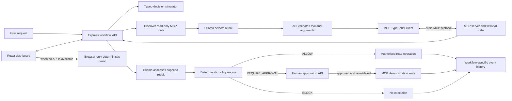

# AgentOps Playground

**Understand. Decide. Act. Safely.**

AgentOps Playground is a free, local-first customer-support triage demo for exploring how generative AI, bounded typed decisions, MCP tools, deterministic policy, and human approval fit together. It uses fictional data only. The static GitHub Pages site also has a deterministic browser demo that requires no backend, API key, or model.

## What is real and what is simulated

| Component | Local application | Public GitHub Pages demo |
| --- | --- | --- |
| Generative AI | Real inference from local Ollama using `qwen2.5:1.5b` | Deterministic browser content; no model runs |
| Typed decisions | Deterministic Jev-inspired project simulation | Same simulation in the browser |
| Jev / TypeSafe AI | Not integrated; no Jev API or SDK | Not integrated |
| MCP | Official TypeScript SDK client and server over stdio | Illustrative events and tools, explicitly labelled simulated |
| Policy and approval | Express API evaluates actions and enforces approval | Illustrative only; browser state does not enforce permissions |

The decision simulator returns Choice-, Noul-, and Score-inspired typed outputs using project rules. It is not the Jev model, does not call TypeSafe AI, and does not provide calibrated probabilities or confidence scores.

## Architecture



The diagram shows component responsibilities. At runtime, the API validates the request and calculates simulated decisions, discovers MCP tools, asks Ollama for a validated read-only tool selection, calls the MCP server, and supplies the actual result to Ollama for assessment. The policy engine separately evaluates the proposed action. Ollama cannot invoke write tools, set permissions, or approve actions.

## Technology

- **Frontend:** React, TypeScript, Vite, CSS.
- **Backend:** Node.js, TypeScript, Express.
- **Local AI:** Ollama with `qwen2.5:1.5b`; no hosted inference or API keys.
- **Tool protocol:** Official `@modelcontextprotocol/client` and `@modelcontextprotocol/server` TypeScript SDK, stdio transport.
- **Shared core:** Deterministic decision simulator, workflow types, and policy engine.
- **Tests:** Vitest, including a real MCP stdio client/server integration test.
- **Public hosting:** GitHub Pages for the static web build only.

## Requirements

- Node.js 22 and npm 10 or newer.
- Ollama for local AI mode. It is free local software; no cloud account or API key is needed.
- GitHub Actions and GitHub Pages for the public static site.

## Install and run locally

From the repository root:

```bash
npm ci
```

Start Ollama in its own terminal if it is not already running:

```bash
ollama serve
```

Download the model once, then confirm it is installed:

```bash
ollama pull qwen2.5:1.5b
ollama list
```

Start the local API in another terminal:

```bash
npm run dev:api
```

The API listens on `127.0.0.1:3001`. It starts and owns one persistent MCP server child process over stdio; there is no separate MCP server command needed for the normal application. Start the Vite frontend in another terminal:

```bash
npm run dev
```

Open the URL printed by Vite (normally `http://localhost:5173`). When the local API is reachable, the dashboard uses local mode. The API connects to Ollama at `http://127.0.0.1:11434` and the frontend proxies `/api` to Express.

To explore policy outcomes, choose one of these in the playground:

- **Read existing ticket · ALLOW** — performs a permitted read through MCP.
- **Change ticket priority · REQUIRE APPROVAL** — waits for approval in the frontend and revalidates policy before the MCP write.
- **Delete ticket · BLOCK** — remains prohibited, even if a user tries to approve it.

Press Ctrl+C in each terminal to stop its process. Stopping the API closes its MCP client and server process. MCP tickets and knowledge-base content are in memory and reset when the API-owned MCP server restarts.

### Ollama settings

The defaults work without a `.env` file. `.env.example` documents optional variables, but the project does not load `.env` automatically. Set overrides in the same shell that starts the API:

```bash
OLLAMA_BASE_URL=http://127.0.0.1:11434 OLLAMA_MODEL=qwen2.5:1.5b OLLAMA_TIMEOUT_MS=90000 npm run dev:api
```

`MCP_TOOL_TIMEOUT_MS` controls MCP tool call timeouts (default: 8000 ms). `API_HOST` defaults to loopback `127.0.0.1`; `API_PORT` defaults to `3001`.

## MCP server and client

The MCP server owns the fictional tickets and support knowledge base for the local application session. It exposes:

- `list_tickets`
- `get_ticket`
- `search_knowledge_base`
- `propose_ticket_action` (proposal only)
- `update_ticket_priority` (fictional data write)

The API owns workflow IDs, ordered per-workflow events, policy decisions, and approval records. Its SDK client discovers tools from the persistent MCP server and invokes them over the actual stdio MCP protocol. The model can select only from a small allow-list of discovered, read-only tools. The API checks both the discovered schema and action-specific constraints before calling a tool. MCP and Ollama failures stop the workflow; no fake live result is substituted.

The server can also be started by a compatible local coding agent using Node.js with `--import tsx` and the absolute path to `apps/mcp-server/src/server.ts`. That creates a separate server process with its own in-memory fictional data. Tool calls in that separate process do not pass through the AgentOps Express policy API. Use only trusted local clients and do not expose the server or the unauthenticated API to an untrusted network.

## Browser-only demo

The frontend falls back to deterministic browser mode when the local API is unavailable. It demonstrates the scenarios, typed simulated decisions, illustrative timeline, MCP tool definitions, policy outcomes, approval preview, and static sample metrics. Browser demo actions do not modify server data, run Ollama, or call MCP. The UI labels those interactions as simulated and states that browser mode does not enforce permissions. This is the mode used by GitHub Pages.

## Tests and builds

Run the full automated suite (includes the real MCP stdio integration test):

```bash
npm test
```

Run only the genuine MCP protocol integration test:

```bash
npm test -- apps/api/src/mcp.integration.test.ts
```

Build the MCP server and API TypeScript checks, then the static frontend:

```bash
npm run build
```

Build only the static site, as the Pages workflow does:

```bash
npm run build --workspace @agentops/web
```

Check dependency advisories:

```bash
npm audit
npm audit --omit=dev
```

Preview the built website locally with `npm run preview`.

## GitHub Pages deployment

The repository workflow at `.github/workflows/deploy-pages.yml` builds only `apps/web/dist` and uploads only that static frontend. It does not publish Express, Ollama, or the MCP server. Vite is configured for the repository path `/Agentops_Playground/`, so the project site and its assets use the correct subpath.

To publish:

1. In the GitHub repository, open **Settings → Pages** and set **Build and deployment → Source** to **GitHub Actions**.
2. Push or merge the reviewed workflow and frontend changes to the `main` branch, or run **Build and deploy GitHub Pages** with **workflow_dispatch** from `main` in the Actions tab.
3. Check the workflow build and deployment jobs. The Pages site will be at `https://<owner>.github.io/Agentops_Playground/`.

Pull requests targeting `main` run the static build but do not deploy. The workflow uses GitHub's Pages deployment token with scoped Actions permissions and requires no repository secret, model key, or external service credential.

## Security limits

- All tickets and documentation are fictional and held in memory.
- The API binds to loopback by default, has no authentication, and is for trusted local use only. Do not bind it to a public interface or expose the MCP process to an untrusted network.
- Express independently validates proposed actions, stores the immutable approval action, rechecks policy at approval and execution, and rejects duplicate or concurrent execution. The model and frontend cannot grant permissions.
- The MCP server has a write tool because the demonstration includes a real tool operation. The AgentOps workflow only calls it after policy authorization and required approval. A separate MCP client that starts its own server process does not use the Express policy boundary and has a separate in-memory data set.
- The simulator is not the actual Jev or TypeSafe AI system. Ollama output is generated locally but may still be inaccurate; recommendations are constrained to supplied fictional data and are not operational support advice.
- The public website is static and unauthenticated. Its approvals and policy outcomes are illustrative browser behavior, not a security boundary.
- `.env` files are ignored by Git; `.env.example` contains only local defaults. Do not put secrets or real customer data in this repository.

## AI-Assisted Development

OpenAI Codex was used as a coding assistant during development to help explore implementation approaches, write and refine code, debug issues, and improve test coverage.

The project was iteratively developed and validated through automated tests, build checks, dependency audits, and local end-to-end testing. AI-generated changes were reviewed against the intended architecture and security boundaries.

AI-assisted development was also an opportunity to explore how coding agents can contribute to real software engineering workflows.

## Repository layout

```text
apps/
  web/          React, TypeScript, Vite dashboard and browser demo
  api/          Express orchestration, Ollama adapter, approval/policy API, MCP client
  mcp-server/   MCP stdio server and authoritative fictional session data
packages/
  core/         typed-decision simulation, policy engine, shared workflow contracts
.github/
  workflows/    static GitHub Pages build and deployment
```
